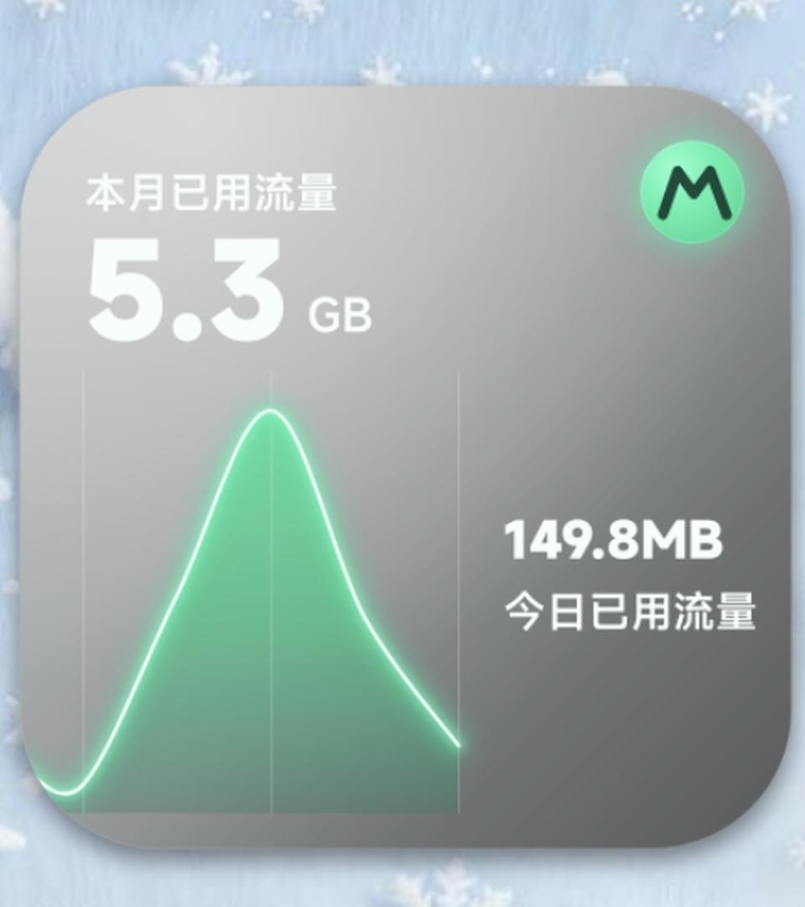
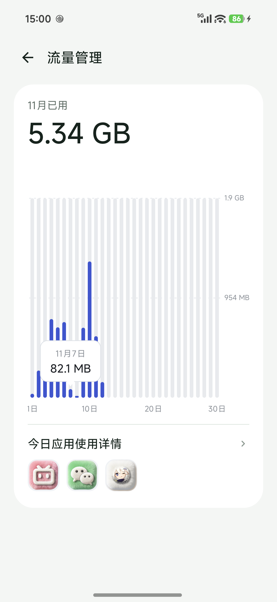

# 移动流量小部件

一个只给自己用的 Android 桌面小部件：包含 **2x2（纯代码绘图版）** 和 **2x1（柔光玻璃胶囊版）** 两个尺寸。显示本月已用流量、今日已用流量，以及用最近 5 天 + 今日数据绘制的平滑曲线。点击小部件会打开“流量管理”页，页内右上角的齿轮进入应用主界面（授权、预览、流量统计范围设置）。

已在 **Redmi K100 Pro Max（设备代号 M098FE，Android 17 / API 37，HyperOS 4.0）** 上安装并验证。流量管理页、柱状图点击气泡、日/周/月切换、“今日应用使用详情”跳转和流量统计范围切换均已实测；全局解锁广播与 15 分钟心跳刷新已接入。

| 桌面 2x2 小部件 | 桌面 2x1 小部件 | 流量管理页 |
| --- | --- | --- |
|  |  |  |

> 桌面截图已使用修复后的版本，小部件的“今日”现在取今天 00:00 → 现在。

## 已验证环境

| 项目 | 版本 |
| --- | --- |
| 手机 | Redmi K100 Pro Max，Android 17 / API 37，HyperOS 4.0（V816） |
| 屏幕 | 1200 × 2608 px，480 dpi |
| Android Studio | 2026.2.2 |
| Gradle | 9.6.0 |
| Android Gradle Plugin | 9.5.1 |
| compileSdk / targetSdk | 37 |
| minSdk | 26 |
| 语言 | Java 17 |

> 这个工程只针对自己的手机，没有做上架、机型适配和多语言。代码里没有第三方依赖。

## 1. 从 Android Studio 新建工程

1. 打开 Android Studio，选择 **New Project**。
2. 选择 **No Activity**（如果这个版本没有该模板，选 **Empty Views Activity**，后面替换掉模板生成的 Activity 即可）。
3. 填写：
   - Name：`DataManager`
   - Package name：`com.example.trafficwidget`
   - Language：`Java`
   - Minimum SDK：`26`
   - Build configuration language：`Kotlin DSL`
4. 创建完成后，确认 `app/build.gradle.kts` 中的 SDK 配置：

```kotlin
android {
   namespace = "com.example.trafficwidget"
   compileSdk {
      version = release(37)
   }
   defaultConfig {
      applicationId = "com.example.trafficwidget"
      minSdk = 26
      targetSdk = 37
   }
   compileOptions {
      sourceCompatibility = JavaVersion.VERSION_17
      targetCompatibility = JavaVersion.VERSION_17
   }
}
```

5. 如果直接打开本仓库，Android Studio 会自动读取已有的 Gradle 配置；无需重复新建。

## 2. 工程结构

```text
DataManager/
├── app/src/main/
│   ├── AndroidManifest.xml
│   ├── java/com/example/trafficwidget/
│   │   ├── MainActivity.java              # 授权、预览、手动刷新、设置流量统计范围
│   │   ├── TrafficApplication.java        # 全局 Application，动态注册解锁广播
│   │   ├── TrafficSettings.java           # 统计范围：仅数据流量 / 仅WLAN / 全部
│   │   ├── StatsRepository.java           # NetworkStatsManager 读取流量
│   │   ├── StatsFormat.java               # MB / GB 格式化
│   │   ├── UsageAccess.java               # 使用情况访问权限检查
│   │   ├── WidgetRenderer.java            # 2x2 Canvas 绘制整张卡片
│   │   ├── WidgetUpdater.java             # 把已加载数据写成 RemoteViews (兼容双尺寸)
│   │   ├── WidgetUpdateScheduler.java     # 15 分钟 JobScheduler 心跳
│   │   ├── RefreshController.java         # 亮屏/解锁判断 + 今日增量/跨天补刷
│   │   ├── StatsCache.java                # 上次数据与日期缓存
│   │   ├── ScreenStateReceiver.java       # 解锁/亮屏广播入口（已被动态注册替代）
│   │   ├── WidgetRefreshJobService.java   # 周期任务服务
│   │   ├── TrafficWidgetProvider.java     # 2x2 小部件 Provider
│   │   ├── TrafficWidget2x1Provider.java  # 2x1 胶囊小部件 Provider
│   │   ├── WidgetLogger.java              # 刷新日志（文件 + 保留最近 100 条）
│   │   ├── MonthlyUsageActivity.java      # 点击小部件进入的流量管理页（日/周/月）
│   │   ├── MonthlyUsageChartView.java     # 本月每日柱状图/点击气泡
│   │   ├── MonthlyUsageRepository.java    # 本月每日用量（按天缓存）
│   │   ├── PeriodBarChartView.java        # 周 / 月柱状图（数值标签 + 平均虚线）
│   │   ├── PeriodUsageRepository.java     # 近 10 周 / 近 6 个月聚合（桶缓存）
│   │   ├── SwipeTabLayout.java            # 卡片区域左右滑动切换日/周/月
│   │   ├── DataUsageProxyActivity.java    # “今日应用使用详情”系统页面跳板
│   │   ├── BootReceiver.java              # 重启/升级后重新调度
│   │   └── Intents.java                   # HyperOS 系统页面兼容
│   └── res/
│       ├── layout/activity_main.xml
│       ├── layout/widget_root.xml         # 2x2 布局 (单 ImageView)
│       ├── layout/widget_root_2x1.xml     # 2x1 布局 (透明背景图 + TextView)
│       ├── drawable-nodpi/widget_preview.png
│       ├── drawable-nodpi/bg_widget_glass.png # 2x1 柔光玻璃背景图
│       ├── xml/traffic_widget_info.xml
│       └── xml/traffic_widget_2x1_info.xml
├── docs/
└── README.md
```

## 3. 权限与系统入口

`AndroidManifest.xml` 里的权限：

```xml
<uses-permission
        android:name="android.permission.PACKAGE_USAGE_STATS"
        tools:ignore="ProtectedPermissions" />
<uses-permission android:name="android.permission.RECEIVE_BOOT_COMPLETED" />
```

应用只需要“使用情况访问权限”和开机广播；不申请 `QUERY_ALL_PACKAGES`，也不再枚举已安装应用。

`PACKAGE_USAGE_STATS` 是特殊权限，不能在运行时弹窗直接授予。用户必须到系统的“使用情况访问权限”列表里手动打开：

```text
设置 → 应用 → 特殊应用权限 → 使用情况访问权限 → 移动流量小部件
```

应用里的按钮会直接跳到这个页面。也可以临时用 ADB 验证：

```bash
adb shell appops set com.example.trafficwidget GET_USAGE_STATS allow
adb shell appops get com.example.trafficwidget GET_USAGE_STATS
```

## 4. 流量数据：为什么今日也用 NetworkStatsManager

查询全部应用的设备移动流量：

```java
NetworkStats.Bucket bucket = networkStatsManager.querySummaryForDevice(
        ConnectivityManager.TYPE_MOBILE, null, start, end);
long bytes = bucket.getRxBytes() + bucket.getTxBytes();
```

- `TYPE_MOBILE`：只统计移动网络，不包含 Wi-Fi。
- `subscriberId = null`：匹配所有移动网络（这台上是同一张 SIM）。
- `start` / `end`：本地时区的毫秒时间戳。
- 返回值是整个设备的移动流量，不是单个 App 的流量。
- 内部会自动只统计 metered 移动网络。

本工程读取 6 个日区间：

```text
5 天前、4 天前、3 天前、2 天前、昨天、今天
```

本月则是从“本月 1 日 00:00”到当前时刻。

> 边界计算要特别注意：7 个起点必须是“今天 − 5 天 … 明天”，这样 `daily[5]` 的区间才是“今天 00:00 → 现在”。此前版本误从“今天 − 6 天”开始，导致 `daily[5]` 实际是昨天，界面上的“今日”就会显示昨天的数据。

### 关于用 TrafficStats 查今日流量的建议

我评估后没有把今日改成 `TrafficStats`。原因是：

```text
TrafficStats.getMobileRxBytes()/getTxBytes() 返回的是“设备开机以来”的累计值，
不是“今天 00:00 以来”的累计值。
```

实测这台手机当时已经开机 **1 天 5 小时**；直接把它当今日流量，会把昨天的流量算进来。除非额外在每天 00:00 持久化一个基线，并处理重启、时区和计数器重置，否则无法保证准确。因此：

- 过去 5 天：`NetworkStatsManager`；
- 今日：同样使用 `NetworkStatsManager` 查询“今日 00:00 → 现在”；
- 本月：同样使用 `NetworkStatsManager` 查询“本月 1 日 00:00 → 现在”。

这样三个数字来自同一个数据源，口径一致，也不会把昨天算进今天。

## 5. 小部件外观与双尺寸兼容
5.1 2x2 小部件（纯代码绘图）
WidgetRenderer.java 把整张卡片画在 1000 × 1000 的设计画布上，再缩放到小部件实际像素。6 个数据点的 x 坐标依次是：卡片左侧边缘(26)、第 1 条竖线(104)、第 1、2 条竖线中点(219)、第 2 条竖线(335)、第 2、3 条竖线中点(450)、第 3 条竖线(565)。曲线用 Catmull-Rom 风格的三次贝塞尔连接，绿色渐变只在曲线下方。

5.2 2x1 胶囊小部件（半透明图片 + 原生文字）
背景：使用一张 100% 透明度的柔光玻璃边框 PNG (bg_widget_glass.png)，中间完全透明。在 widget_root_2x1.xml 中通过 ImageView 以 centerCrop 模式铺满。

文字：使用原生的 TextView 叠加在背景上。这样每次刷新时，系统只需重写文字图层，不会重新加载背景图片，极大节省功耗。

5.3 渲染分发机制
在 WidgetUpdater.updateSingleWidget 中，通过获取 AppWidgetProviderInfo.initialLayout 来判断当前正在刷新的组件。如果是 widget_root_2x1，则把解析好的数字和单位分别填入 tv_today_value 和 tv_today_unit；如果是 widget_root，则调用 WidgetRenderer 生成 Bitmap。

## 6. 小部件点击与流量管理页

点击小部件现在打开 MonthlyUsageActivity，界面上方是 日 / 周 / 月 分段切换（点标签或在下方白色卡片区域左右滑动都能切换），下面同一张卡片显示对应口径的数据：

日

“11月已用 / 5.34 GB”月度总量；

30 个灰色竖条（数量严格等于本月天数）；

每天一个蓝色柱子，柱子高度对应当天流量；

下方只标注 1日、10日、20日、30日（2 月自动过滤 30 日）；

纵轴两条虚线：上面一条画在单日最大值 × 1.3 处（因为柱状图单独缩放，它落在图表约 87% 高度，不在顶端），下面一条画在上面一条的一半处，数值四舍五入到 1 位有效数字（例如 1.2 GB → 1 GB、477 MB → 500 MB）；

柱状图独立缩放：本月单日最大值占图表高度的 67%；

点击任意灰色竖条，在当天蓝色柱子上方弹出气泡，显示“11月7日 / 82.1 MB”。

周 / 月

周：本周（周一 → 今天）加之前 9 个完整周，共 10 根柱子；标签是周一日期，当前周显示“本周”。

月：本月加之前 5 个月，共 6 根柱子；标签是“10月”“11月”。

顶部是“近10周总量 / 近6个月总量”，下面是柱状图：每根柱子上方标数值（1.2G、860M），虚线表示平均值；虚线左端上方写“平均每月 / 平均每周”，下方写具体平均值（如 53.38 GB），这两行文字在图表左侧占出一块空间，柱子和虚线从文字右侧开始；柱状图下方用浅蓝条总结最大值，如“10月上网用量最多-91.96 GB”。

卡片高度固定为日视图的高度：图表区域始终 384dp（周/月图表填满同一区域），切换 tab 时卡片不会变高变矮。

切换 tab 有滑动动画：当前内容向一侧滑出、新 tab 的骨架（“—”、空图表）从另一侧滑入，数据到达后再填充。

图表下方这一行始终显示，点击进入系统“流量排行”：日 tab 文案为“今日应用使用详情”，周 / 月 tab 文案为“流量排行”。

齿轮按钮与返回行为
齿轮不再弹出统计范围对话框，点击后直接打开 MainActivity（同一任务里入栈）；主界面左上角是“返回箭头 + 设置”标题栏，点箭头回到流量管理页。

小部件点击用 NEW_TASK | CLEAR_TASK 启动 MonthlyUsageActivity：它永远是任务里唯一的页面。即使之前从齿轮进过主界面、任务栈顶部是 MainActivity，点小部件也一定落在流量管理页；从这一页用系统返回/返回手势，任务清空，直接回到桌面。

如果期间改过统计范围，流量管理页在 onResume 里检测到模式变化会自动重新查询并重绘。

### 流量统计范围

统计范围存在 `TrafficSettings`（`SharedPreferences`：`traffic_widget_settings` / `traffic_mode`），三个取值：

| 值 | 界面文案 | 统计内容 |
| --- | --- | --- |
| `MODE_MOBILE`（默认） | 仅数据流量 | `TYPE_MOBILE`（metered 移动网络） |
| `MODE_WLAN` | 仅WLAN流量 | `TYPE_WIFI` |
| `MODE_ALL` | 全部流量 | 两者相加 |

`StatsRepository.queryRange()` 在每次查询时读取当前模式并按需累加，因此小部件的曲线和“本月 / 今日”两个数字、流量管理页的月总量 / 每日柱子 / 周月柱状图都会跟着切换。切换后会清空 `StatsCache`，让下一次刷新走全量查询，避免把旧口径的缓存直接相加。

### 本月每日数据

`MonthlyUsageRepository` 从本月 1 日开始逐天查询：

```java
NetworkStats.Bucket bucket = manager.querySummaryForDevice(
        ConnectivityManager.TYPE_MOBILE, null, dayStart, dayEnd);
```

未来日期不查询，柱状图保持 0。月总量单独查询“本月 1 日 00:00 → 现在”。已经结束的日期会写入 `traffic_widget_month_days`，下次打开只补查今天。

### “今日应用使用详情”跳转

这一行点击后走 `DataUsageProxyActivity`，按以下顺序打开系统页面：

1. HyperOS 的 `miui.intent.action.NETWORKASSISTANT_TRAFFIC_SORTED`（直接进入“流量排行”）；
2. 显式组件 `com.miui.securitycenter/.networkassistant.ui.activity.TrafficSortedActivity`；
3. HyperOS / AOSP 的 `android.settings.DATA_USAGE_SETTINGS`（显式 Settings 组件）；
4. MIUI 的 `miui.intent.action.NETWORKASSISTANT_ENTRANCE`；
5. 通用 `DATA_USAGE_SETTINGS`、无线设置 / 设置首页兜底。

实测点击后直接进入 **“流量排行”** 页面，不再需要先经过“网络助手”首页再点一次。

> 注意：Network Assistant 卡片展示的是 SIM / 套餐口径；本页是 Android `NetworkStats` 的设备总流量口径，两者可能不同，尤其是免流、定向流量、热点、VPN 或双 SIM 场景。

## 7. 屏幕状态驱动的刷新机制 (HyperOS 对抗版)

由于澎湃OS (HyperOS) 的底层限制，在 AndroidManifest.xml 中静态注册的亮屏/解锁广播会被系统完全拦截；同时，系统桌面在解锁或回桌面时不会触发 onAppWidgetOptionsChanged 回调。因此，本工程采用以下三层驱动方案：

第一层：全局动态广播（极速响应）
在 TrafficApplication.java 的 onCreate 中，使用 Application Context 动态注册 ACTION_USER_PRESENT（解锁广播），且不注销。只要 App 进程存活，每次解锁都会瞬间触发 RefreshController.refreshIfAllowed 刷新小部件。

第二层：15 分钟心跳兜底（防杀后台）
WidgetUpdateScheduler 注册一个 persisted 的 JobScheduler 心跳（周期 15 分钟）。即使 App 被从最近任务划掉（进程被杀），系统闹钟也会在后台将其唤醒。

WidgetRefreshJobService 在后台线程调用 RefreshController.refreshIfAllowedBlocking()，完成后再 jobFinished()。

RefreshController 会先检查 PowerManager.isInteractive() 和 KeyguardManager.isKeyguardLocked()；屏幕关闭或锁屏时直接返回，不查询流量、不更新小部件。

第三层：手动/前台刷新
用户打开 App 时，MainActivity.onResume 和手动点击“刷新数据”都会强制执行刷新并更新所有小部件。

跨天补刷
StatsCache 持久化保存 dayKey (yyyy-MM-dd) 和 monthKey (yyyy-MM)。如果日期跨越，会触发全量刷新本月和过去 5 天的数据；同一天则只查询今日增量并加到本月总量上。

刷新日志
两个尺寸的小部件共用刷新逻辑。每次刷新尝试都会向 files/widget_refresh.log 写入一行，保留最近 100 行。在主界面点击“查看刷新日志”可以以等宽字体查看并清空。
日志格式示例：

```text
[17日13:26:59]收到解锁广播，全量刷新：2*2界面(ID: 28) 成功；2*1界面(ID: 35) 失败，原因：IllegalArgumentException
[17日13:31:12]15分钟定时任务，增量刷新：2*2界面(ID: 28) 成功；2*1界面(ID: 35) 成功，数据：152.3 MB
```

## 8. 构建与安装

### 构建

```bash
./gradlew assembleDebug
```

生成的 APK：

```text
app/build/outputs/apk/debug/app-debug.apk
```

本仓库也复制了一份到：

```text
dist/DataManager-debug.apk
```

### 安装

普通 ADB 安装：

```bash
adb install -r app/build/outputs/apk/debug/app-debug.apk
```

这台 HyperOS 上直接 `adb install` 会被“USB 安装管理”拦截，报：

```text
INSTALL_FAILED_USER_RESTRICTED: Install canceled by user
```

不需要关闭系统安全设置，改用 push + 系统包管理器即可：

```bash
adb push app/build/outputs/apk/debug/app-debug.apk /data/local/tmp/trafficwidget.apk
adb shell pm install -r /data/local/tmp/trafficwidget.apk
```

### 授权

打开应用，点“授予使用情况访问权限”，在系统列表里打开开关。也可以：

```bash
adb shell appops set com.example.trafficwidget GET_USAGE_STATS allow
```

## 9. 添加小部件（手动）

HyperOS 的“支持小部件应用”列表会做自己的筛选，第三方侧载应用不一定会出现在里面。正确的完整列表入口是：

```text
长按桌面空白处
→ 添加小部件
→ 全部应用
→ 安卓小部件
→ 移动流量
→ 添加到桌面
```

小部件默认是 2 × 2 单元格，可以横向/纵向调整大小。

> 应用内的“添加小部件到桌面”按钮已经移除（HyperOS 的 `requestPinAppWidget()` 在 `setup_widget` 阶段返回 `permission denied`，自动放置不可用）。请按上面的手动路径添加。

## 10. 自检清单

### 真机已验证

- [x] 本月总量 5.34 GB，今日 149.8 MB，与系统“流量排行”当天总量一致。
- [x] 修正日区间边界：`daily[5]` 现在是今天 00:00 → 现在，不再是昨天。
- [x] 桌面 2 × 2 小部件正常显示，绿色渐变只在曲线下方。
- [x] 点击小部件打开新的“流量管理”页面。
- [x] 本月灰色竖条数量与 11 月天数一致（30 个）。
- [x] 点击柱子弹出“11月7日 / 82.1 MB”气泡。
- [x] 点击“今日应用使用详情”进入系统“流量排行”。
- [x] 齿轮打开应用主界面；主界面的“流量统计范围”值显示行（左侧名称、右侧当前取值 + 箭头）点击可三选一，选完立即刷新预览、流量管理页和小部件。
- [x] 流量管理页用 `NEW_TASK | CLEAR_TASK` 打开，返回直接回到桌面。

### 屏幕状态刷新

- [x] `RefreshController` 在查询前检查亮屏 + 解锁状态。
- [x] 同一日期只查询今日；跨日期全量刷新本月和过去 5 天。
- [x] JobScheduler 心跳周期为 15 分钟，熄屏/锁屏时直接返回。
- [x] 解锁广播入口和 JobScheduler 兜底路径均已接入。
- [ ] 连续亮屏 15 分钟、跨天补刷和 HyperOS 是否投递 `USER_PRESENT` 仍需长时间观察。

## 11. 常见问题

### 小部件显示“—”

说明没有“使用情况访问权限”，或者权限刚授予但小部件还没刷新。打开应用授权，再点“刷新数据”。

### 数字一直不更新

1. 打开应用点一次“刷新数据”，确认能读到数据；
2. 检查 HyperOS 的省电策略和自启动；
3. 检查 `adb shell dumpsys jobscheduler` 是否有 `WidgetRefreshJobService` 的 15 分钟任务；
4. 若解锁后没有立刻更新，先等下一次 15 分钟心跳；Android 8+ 不保证 Manifest 接收 `USER_PRESENT`；
5. 若日期已经跨天，下一次刷新会自动全量补刷本月和过去 5 天。

### 小部件“今日”和系统差了一整天

这是旧版本的日区间 off-by-one 已修复的问题。7 个起点必须是“今天 − 5 天 … 明天”，`daily[5]` 才是今天。旧版从“今天 − 6 天”开始，最后一个点实际是昨天。

### 和运营商/系统页面数字不一致

Android 的 `NetworkStats` 统计设备上的 IP 流量（接收 + 发送），可能包含免流、热点、VPN、系统流量等；运营商账单和 SIM 套餐页面可能只统计计费流量。这不是同一个口径。可以和“流量排行 → 当天数据流量”对照，它和本页的今日值更接近。

### 想改成只统计某一个 App

把 `querySummaryForDevice()` 换成：

```java
queryDetailsForUid(ConnectivityManager.TYPE_MOBILE, null, start, end,
        applicationInfo.uid)
```

然后累加每个 Bucket 的 RX/TX。但此时小部件显示的就是该 App 自己的流量，不是整机流量。

## 12. 关键设计取舍

- **整张卡片用 Canvas 绘制**：RemoteViews 不支持自定义 View；用单个 `ImageView` 画全部内容，能稳定实现渐变、模糊、圆角和自定义曲线。
- **曲线用位图而不是多个 View**：不需要 `RemoteViewsService`，刷新逻辑更简单。
- **历史和今日共用 NetworkStatsManager**：保证口径一致，避免 TrafficStats 的“开机以来累计”问题。
- **屏幕状态驱动**：屏幕未点亮或仍锁屏时绝不查询流量；JobScheduler 仅用于 15 分钟心跳。
- **日期缓存**：同一天只补今日增量，跨天才重新读取过去 5 天和本月，减少后台查询。
- **解锁广播 + 心跳兜底**：Manifest 广播不可靠时，最迟由下一次 15 分钟心跳补刷。
- **统计范围设置只放主界面**：齿轮只负责跳转主界面，设置项、小部件和两个页面共用同一份 `TrafficSettings`，切换后清缓存并全量重查。
- **流量管理页独占任务内容**：小部件用 `NEW_TASK | CLEAR_TASK` 打开，任务里只有这一页，点击必到该页、返回必回桌面。
